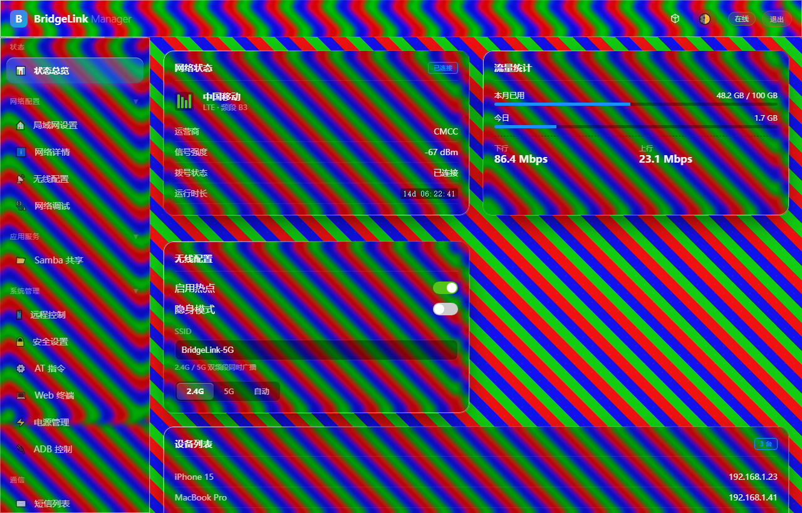
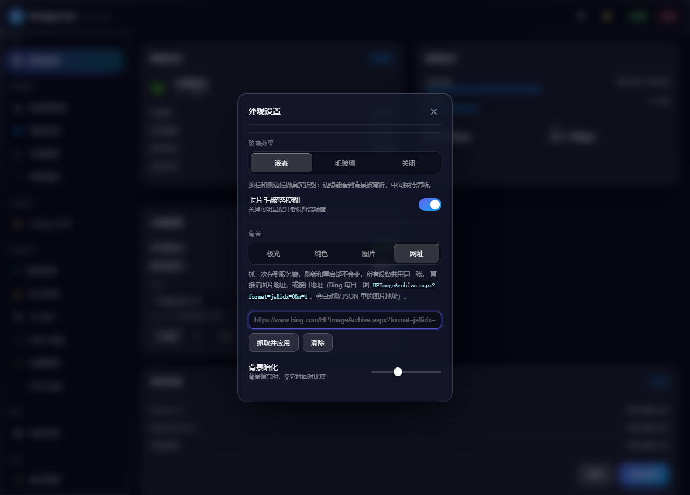

# OpenGW (WebManagerLite自用)

一个运行在某兴安卓随身 WiFi 上的网关管理工具，增加一些高级功能，用来替换原厂简陋受限的 Web 管理页面。我自己用的，开源出来，同款设备的朋友如果喜欢的话可以拿去用。

[OpenGW-mobile](https://github.com/leehe-byte/WebManagerLite-mobile)：手机端免登录管理版本，可切换官方与自用web

---

## 🌟 核心优势
- **极速投屏**：支持 Web 远程控制，深度优化实时预览，体验更流畅。
- **系统性能中心**：全新的 Windows 资源管理器风格性能面板，支持多核 CPU、内存、Swap 及存储实时监控。
- **桥接协议**：深度劫持并重构原厂 GoForm 协议，解锁隐藏的网络参数与控制权限。
- **极客工具**：支持 Mihomo 代理（插件安装）、ttyd 全功能终端、Samba 存储共享、自定义 AT 指令下发。

---

## 🛠️ 当前功能矩阵 (Current Version: v3.1.0)

### ✅ 已稳定实现 (Stable)
- **模块化架构**：全站逻辑实现 JS 模块化解耦（Overview, NetInfo 等），加载更高效，维护更简单。
- **性能实时监控**：Windows 风格实时 Canvas 核心波形图，支持 8 核/多核动态适配，新增存储条监控。
- **黑暗模式**：全系统级别的深色/浅色/自动切换，完美适配移动端与 PC 端。
- **远程桌面**：Web 端直接操作 Android 界面，内置仿真虚拟导航栏，支持滑动与长按手势。
- **网络详情**：支持 5G SA/NSA 识别，RSSI/RSRP 可视化进度条，集成 WiFi 黑名单管理。
- **蜂窝控制**：支持 SIM 卡槽切换及 5G/4G/3G 频段模式锁定。
- **USB 自动关 WiFi**：USB 设备连接时自动关闭 WiFi，断开后自动恢复，支持手动开关。
- **插件系统**：外部可安装 `.owpkg` 插件（免重启），支持侧边栏菜单、独立页面、overview 卡片与通用能力 API。开发指南见 [docs/PLUGIN_DEV.md](docs/PLUGIN_DEV.md)，最小示例见 `examples/demo-plugin`。
- **液态玻璃皮肤**：可选的外观，顶栏 / 侧边栏 / 内容卡片按各自圆角把背后背景**真折射**（不是普通模糊），详见 [液态玻璃](#-液态玻璃皮肤)。

### ⏳ 持续演进中 (Roadmap)
- [ ] **网络调试**：集成 Ping、Traceroute、Iperf3 等诊断工具。
- [ ] **文件管理**：内置 Web 端文件浏览器，支持上传下载与解压。
- [ ] **自动化脚本**：支持根据电池、时间等条件自动执行网络切换。

---

## 🧊 液态玻璃皮肤

> 在 **`feature/liquid-glass`** 分支上，还没合并到 main。

模仿 iOS 26 那种液态玻璃，但做的是**真折射**而不是普通的毛玻璃：
顶栏、侧边栏、内容卡片会按各自的圆角形状把背后的背景**弯折**，
所以边缘能看出内容被挤压，中间保持清晰。

### 怎么开

顶栏右上角的 🧊 按钮打开「外观设置」（登录页在右下角）。设置存在本机
`localStorage`，背景图存在设备端。

**玻璃效果**三档：

| 档位 | 说明 |
|---|---|
| 液态 | 顶栏 / 侧边栏 / 内容卡片做真实折射 |
| 毛玻璃 | 只做背景模糊，不做折射，最省 |
| 关闭 | 回到原来的外观，不留任何 DOM 残留 |

**背景**四种：极光（默认，四团缓慢漂移的渐变 + 噪点和点阵纹理）、纯色、本地图片、
网址。

> **换成有细节的照片时折射会明显得多。** 极光是柔和渐变，弯折它几乎看不出来 ——
> 想看这个效果，务必换一张自己的图（下面那个「网址」就行）。

### 背景图网址（服务端缓存）

填一个网址点「抓取并应用」，服务端下载一次后落盘，之后刷新、重启都读本地文件
不再联网，所以图片不会变，换设备 / 换浏览器看到的也是同一张。

支持两类地址：

1. 直接指向图片的 URL
2. 返回 JSON 的接口 —— 会自动从中找图片地址。例如 Bing 每日一图：
   `https://www.bing.com/HPImageArchive.aspx?format=js&idx=0&n=1`
   （取 `images[0].url`，相对路径按接口域名补全）

| 方法 | 路径 | 说明 |
|---|---|---|
| GET | `/api/appearance` | 读当前背景信息 |
| POST | `/api/appearance/background` | 抓取并缓存，body `{url}` |
| GET | `/api/appearance/background` | 返回图片本体 |
| DELETE | `/api/appearance/background` | 清除 |

图片存在 `filesDir/appearance/`。读图这个 `GET` **不校验 token** ——
它要当 CSS `background-image` 用，而 CSS 发不了自定义请求头；写入和清除仍然需要。
这和处理字体资源（`/api/proxy/fonts/`）是同一个理由。

### 实现上踩过的坑

都是踩出来的，记下来免得以后再踩一遍。

**1. 浏览器的 `backdrop-filter` 做不了自定义折射。**
直觉方案是给元素加 `backdrop-filter: url(#filter)`，用 `feImage`（预生成的位移贴图）
喂给 `feDisplacementMap`。实测在 Chromium 里**不生效**：`feDisplacementMap` 本身正常，
`feImage` 也能单独渲染，但 `feImage` 无法作为它的 `in2` 输入。
所以现在是：在玻璃内部**复制一份和页面完全相同的背景**，按元素在视口里的位置
用 JS 设置偏移来对位，再用**普通 `filter: url()`** 做位移 —— 这条路全平台可用。

**2. `in2` 必须用 `result` 名字符串引用。**
写成 `disp.setAttribute('in2', imgElement)` 会被字符串化成
`"[object SVGFEImageElement]"`，匹配不到任何 result，位移贴图等于没接上。
这个错误**肉眼看不出来** —— 折射层显示的就是同一张背景，空转和工作正常长得一模一样。
判断方法：把 `filter` 强制设成 `none` 截一张图，和正常截图比对哈希，一样就是空转。

**3. SDF 梯度必须用解析式，不能用数值中心差分。**
圆角矩形 SDF 内部是 `max(|px|-hw, |py|-hh)`，这个 `max` 在对角线上有个折点。
中心差分跨过折点会算出两边的平均，于是对角线上法线变成 45°，
代入高光公式后一条对角线 `|dot|` 掉到 0（暗线）、另一条变成 1（亮线）——
玻璃上就会出现一个贯穿的 X。

**4. 玻璃层的 `z-index` 必须是负的。**
玻璃层是 `position: absolute`，而卡片内容大多是静态定位。按 CSS 绘制顺序，
`z-index >= 0` 的定位元素会画在静态内容**之上**，底色层会直接盖住卡片正文
（`.card-header` 因为自带 `z-index: 2` 才幸免，所以症状是「标题看得见、表格看不见」）。
改成负值后它们只画在父级背景之上、内容之下，父元素需要 `isolation: isolate`。

**5. `filter` 会创建包含块。**
所以在玻璃内部 `background-attachment: fixed` 会被解析成「相对该元素本身」而不是视口，
图案会像贴纸一样跟着元素走。对位只能靠 JS 每帧算。

### 性能上的处理

- 位移贴图只跟尺寸 / 圆角 / 参数有关、与位置无关，所以**按尺寸缓存滤镜**：
  同一行的卡片共用一张贴图和一条滤镜，而不是一张卡一张。
- 滚动时视口外 ±200px 的卡片会摘掉滤镜（摘掉后显示的仍是与背景对齐的副本，
  视觉上等于没这层）。
- 极光动画锁在 ~15fps。背景每变一次，页面上所有 `backdrop-filter` 都要重新采样一次
  背景，锁帧能省掉约 3/4 开销，而极光动得很慢，看不出区别。
- 页面不可见时自动停掉动画。
- 侧边栏滑动期间临时摘掉折射层，动画结束再挂回来（`filter` 会改变 backdrop root，
  滑动时会让所有毛玻璃卡片一起重算背景，表现为掉帧和闪白）。

### 已知限制

- 顶栏只有 60px 高，折射带窄，效果比侧边栏弱。
- 背景是照片时，正文可读性靠一层 5px 轻模糊 + 半透明底色撑着。
  还是觉得花就用「背景暗化」滑杆把背景压暗。
- 老 WebView（Chromium < 76）不支持 `backdrop-filter`，会自动退化成不透明底色。
- 真机上的流畅度还没验证完，设置面板里留了两个回退开关
  （「内容卡片折射」和整个切「毛玻璃」）。

---

## 🤝 致谢
特别感谢 [UFI-TOOLS](https://github.com/kanoqwq/UFI-TOOLS) 项目及其作者 **kanoqwq**。本项目深受其启发，at-command部分使用了他的 [sendat](https://github.com/kanoqwq/UFI-TOOLS/raw/refs/heads/http-server-version/app/src/main/assets/shell/sendat) 二进制文件(后续也会去掉该依赖)。
Webshell部分使用了tsl0922的[ttyd](https://github.com/tsl0922/ttyd.git)项目。

---

## 🛡️ 安装要求
- **系统**：某兴 u30air / f50（其他同平台设备可能需自行适配）。
- **权限**：必须具备 **Root 权限**（Magisk 或 KernelSU）。（后续可能会设置免root版和root版两种）
- **基础依赖**：`/system/bin/` 下需存在 `ttyd.aarch64`、`sendat` 等工具。（后续会把这些依赖加进软件之中）

## ⚠ 注意事项
修改关键网络参数导致设备连接中断，请在熟悉 Root 操作的前提下使用！！！

## 我想说的一些话，关于本项目
这个md是ai写的，我每次看到这些老感觉乖乖的，我就想在最后写一些我的想法。
这是我自己用的一个软件吧，从一开始拿deepseek写了基础，后面又换成了gemini写了大部分的代码，后面又换到了deepseek到现在，一直都没想好这个软件叫啥比较好，名字是我让ai随便起的，说不定哪天能改一个好名字。
我比较喜欢openwrt的前端和交互，所以风格上比较模仿openwrt。前端里有很多emoji，也懒得换图片，能用就行。
如果有大佬看到了这个小垃圾，也希望嘴下留情。
前一段时间简简单单加了插件系统，有点小问题，会慢慢完善的。
后续会一直随缘提交，如果你要是看上了我这个小垃圾软件的话，也希望把你宝贵的意见留下来❤。